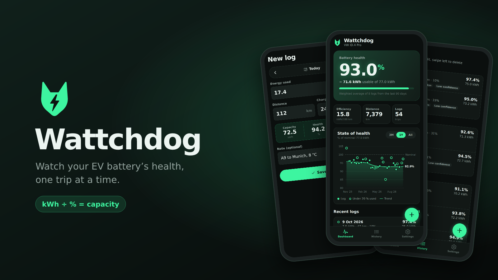
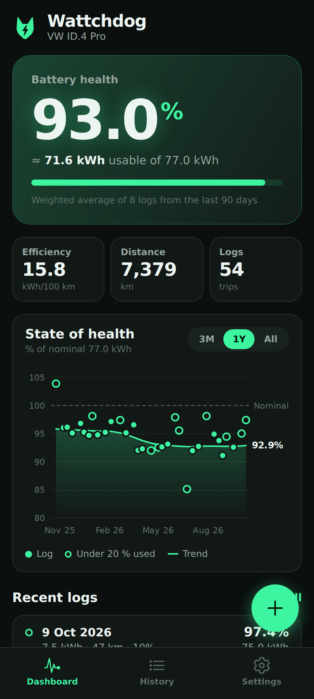
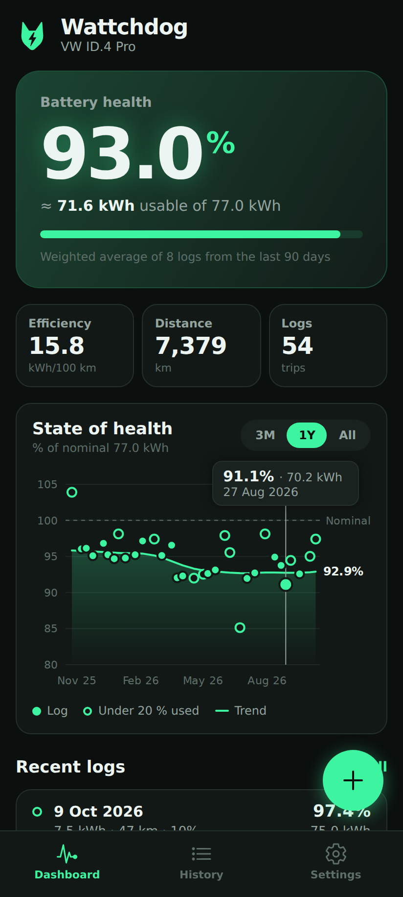
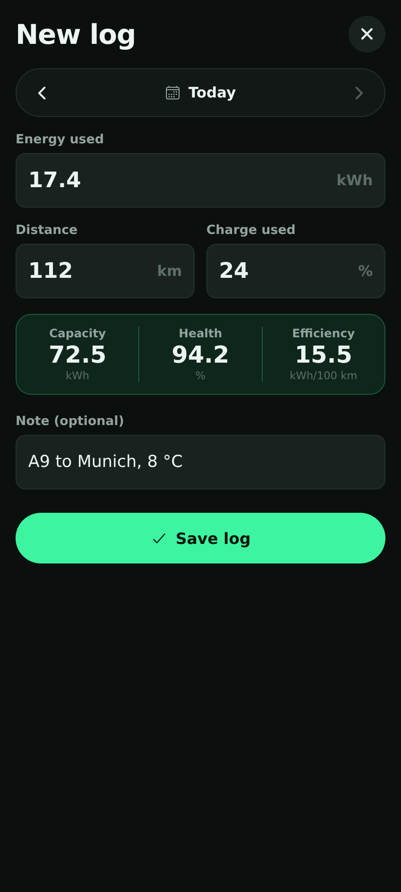
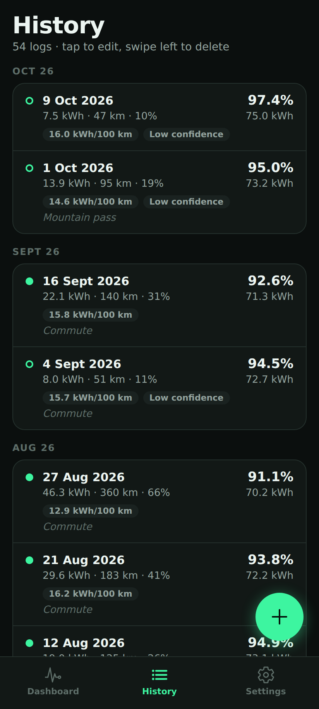
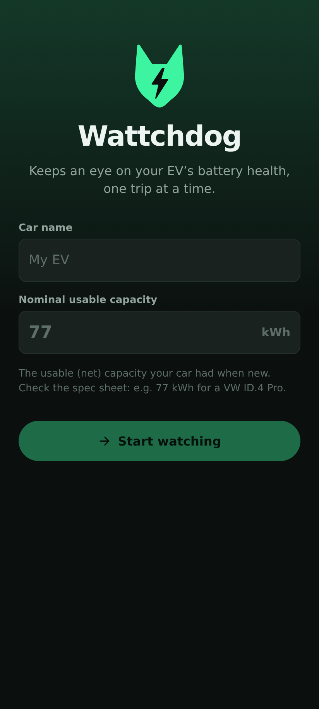
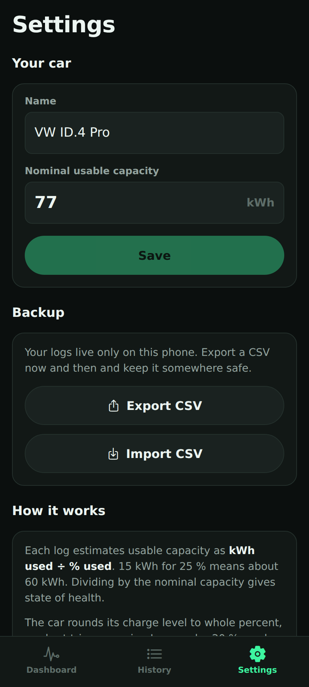
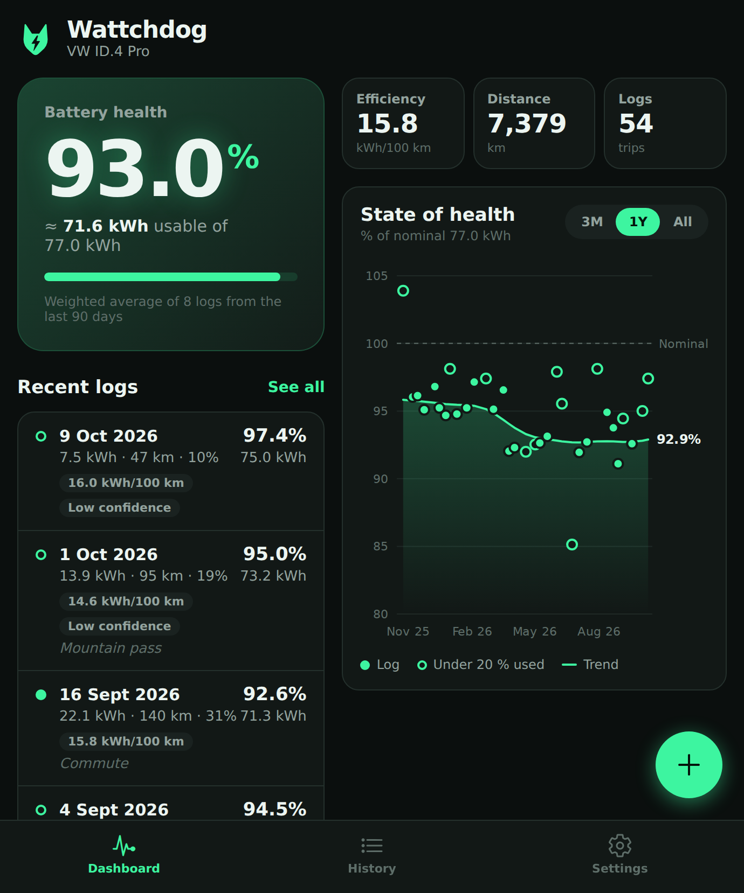
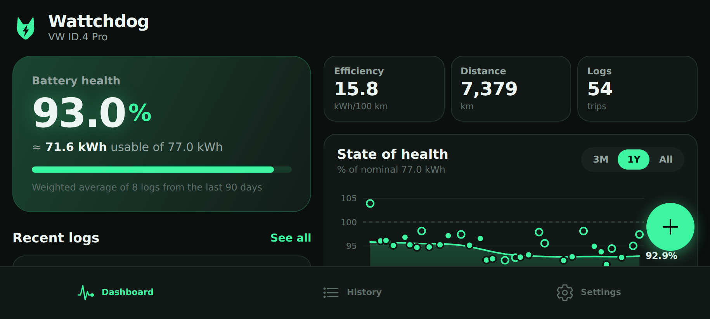

<p align="center">
  
</p>

<p align="center">
  <b>Is your EV battery still the battery you bought?</b><br>
  Wattchdog turns three numbers from your trip computer into a long-term picture of your battery's health.<br>
  No dongle, no account, no cloud.
</p>

<p align="center">
  
  
  
  
</p>

---

## How it works

After a drive, read three numbers off your car and log them:

| You enter | Example |
| --- | --- |
| ⚡ **Energy used** (trip computer) | 17.4 kWh |
| 🛣️ **Distance** | 112 km |
| 🔋 **Charge used** | 24 % |

Wattchdog does the rest:

```
usable capacity  =  kWh used ÷ % used      17.4 kWh ÷ 0.24  =  72.5 kWh
state of health  =  capacity ÷ nominal     72.5 ÷ 77 kWh    =  94.2 %
efficiency       =  kWh ÷ km × 100                          =  15.5 kWh/100 km
```

A single trip can be noisy. Over weeks and months, the trend shows you how your battery is really ageing.

## Features

<table>
  <tr>
    <td width="33%"></td>
    <td width="33%"></td>
    <td width="33%"></td>
  </tr>
  <tr>
    <td><b>One number that matters.</b> Your battery's state of health at a glance: a weighted average of the last 90 days, so a single odd trip can't fool it.</td>
    <td><b>Health over time.</b> Every log is a dot and a smoothed trend line runs through them. Drag across the chart to inspect any trip. Switch between 3 months, 1 year or everything.</td>
    <td><b>Logging takes 10 seconds.</b> Capacity, health and efficiency are calculated live while you type, with a gentle warning if a number looks like a typo.</td>
  </tr>
  <tr>
    <td></td>
    <td></td>
    <td></td>
  </tr>
  <tr>
    <td><b>Full history.</b> Every trip grouped by month with its efficiency and notes. Tap to edit, swipe to delete.</td>
    <td><b>Set up in one screen.</b> Name your car, enter its usable capacity when new, and start watching.</td>
    <td><b>Your data, your phone.</b> Everything stays on the device. Export or import a CSV whenever you like.</td>
  </tr>
</table>

### Made for foldables and landscape

Unfold your phone or turn it sideways and the dashboard opens up into two columns, with a bigger chart.

<p align="center">
  
  
</p>

## Honest maths

The car shows its charge level in whole percent, which makes short trips imprecise. If a trip used 5 %, the real value might be anywhere from 4.5 % to 5.5 %: a ±10 % error before you've even started. Wattchdog deals with this in the open:

- **Low-confidence logs.** Trips under 20 % of charge are drawn as hollow dots and count for about a third as much in every average.
- **Weighted by trip size.** Long trips give the best readings, so they count the most.
- **Smoothed trend.** The trend line uses a 30-day Gaussian time window, so it follows real ageing rather than single outliers.
- **Typo guard.** An estimate more than 25 % away from nominal triggers a warning. You can still save it if it's genuine.

> 💡 **Tip:** use the energy figure from your **car's trip computer**, not from a wallbox. Wallbox readings include charging losses, which make the battery look bigger than it is.

## Getting started

Requirements: [mise](https://mise.jdx.dev) (installs the pinned Node 24 and pnpm), or Node 24+ with pnpm.

```bash
mise install          # Node + pnpm, as pinned in mise.toml
pnpm install
pnpm web              # try it in the browser right away
pnpm android          # or run on an Android emulator / USB-connected phone
```

### Install on your phone

Wattchdog is a personal app. Build it once and install it directly, with no app store needed:

```bash
# Android: a standalone APK you can sideload
npx eas-cli@latest build --platform android --profile preview

# iOS: needs an Apple Developer account for ad-hoc / TestFlight installs
npx eas-cli@latest build --platform ios --profile preview
```

### Scripts

| Command | What it does |
| --- | --- |
| `pnpm start` | Start the Expo dev server |
| `pnpm web` | Run in the browser (data in `localStorage`) |
| `pnpm test` | Unit tests for the capacity maths and CSV import/export |
| `pnpm typecheck` | TypeScript, strict mode |
| `pnpm lint` | ESLint (Expo config) |
| `pnpm icons` | Re-render app icons from the logo in `src/components/logo.tsx` |

## Under the hood

- **[Expo](https://expo.dev) SDK 57** + React Native + TypeScript, with the React Compiler enabled
- **Expo Router** for tabs and the log sheet
- **SQLite** (`expo-sqlite`) for on-device storage, with a `localStorage` fallback on web
- **Hand-built SVG chart** (`react-native-svg`), with no charting dependency
- **CSV backup** through the native share sheet (`expo-sharing`) and file picker (`expo-document-picker`)

```
src/
├── app/                 Screens (Expo Router)
│   ├── (tabs)/          Dashboard · History · Settings
│   ├── log.tsx          Add / edit log sheet
│   └── onboarding.tsx   First-launch setup
├── components/          Chart, log row, logo, UI kit
├── lib/
│   ├── battery.ts       Capacity, SoH, weighting, trend: all the maths
│   ├── csv.ts           RFC 4180 import/export
│   └── repo*.ts         SQLite (native) / localStorage (web)
└── state/store.tsx      App state
```

### CSV format

```csv
date,kwh_used,km,percent_used,note
2026-10-09T17:30:00.000Z,22.1,140,31,Commute
```

Imports skip rows that are already present and report invalid lines by number.

---

<p align="center">
  <sub>Built for one car, one driver, and a healthy amount of curiosity. ⚡🐕</sub>
</p>
